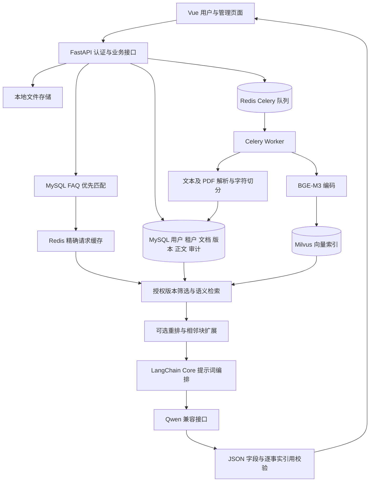

# KnowOps 当前架构与数据流

本项目是模块化单体 FastAPI 应用，Celery Worker 独立运行，Vue 提供用户工作台与管理员控制台。MySQL 保存业务状态和正文，Milvus 保存可重建向量索引，Redis 承载任务队列及结果。本地原始文件位于忽略提交的 `storage/`。MinIO 当前作为 Milvus 的内部依赖，不是应用上传适配器。

## 模块职责

| 模块 | 当前实现 |
| --- | --- |
| auth / tenant | 密码及 Token 登录、公开注册独立租户、平台和租户管理员、成员管理、TOTP、可选 OIDC |
| knowledge | 知识库与成员权限、文档版本、审核发布、删除及失败阶段重试 |
| ingestion | UTF-8 文本、Markdown 和可提取文本的 PDF；固定窗口与结构感知字符切分 |
| retrieval | BGE-M3 与 Milvus 召回、SQL 版本预筛选及回表复核、可选本地重排和同版本邻块补全 |
| chat | 单轮非流式问答、LangChain 生成编排、逐事实引用验证与证据不足拒答 |
| faq | 人工维护带证据的标准问答、阈值匹配、Redis 精确请求缓存 |
| feedback / audit | 回答反馈快照、租户范围审计查询与导出、待审查回归候选 |
| health / system | 存活、依赖就绪、Worker 与任务状态检查 |

## 数据与一致性

上传先保存文件和版本，再向 Redis 投递解析任务。解析成功生成 chunks，索引任务在短事务中获取快照，在事务外编码和写 Milvus，最后写入索引状态。`parsed` 不等于 `indexed`。

检索限定当前身份可读知识库，SQL 选出未下架且当前、已审核、解析和索引成功的版本，将版本白名单传入 Milvus；正文从 SQL 回表读取。索引按块 ID 覆盖写入，重复投递可能重复编码，但不会新增重复主键。

没有消息 outbox、自动卡死租约回收或跨 MySQL／Milvus／磁盘的分布式事务。删除需关注部分失败与残留文件。默认自动审核通过的上传会先选中新版本，在索引就绪前可能暂时没有可检索版本。

## 已实现范围与限制

当前未接入知识图谱、关键词与向量混合召回、扫描件 OCR、流式输出或多轮问题改写。LangChain 只编排生成部分，权限和检索仍为自写业务代码。精确引用匹配不能证明语义正确；开发数据和失败案例见 `evals/`，不能称为独立盲测。

密码默认使用 scrypt 摘要；本机根据演示要求启用了 `PASSWORD_STORAGE=plaintext`。它会在 `users.password_hash` 保存 `plaintext$原密码`，没有加密保护，历史摘要在成功登录后转换。公开仓库默认仍为 scrypt；数据库、原文件、账号凭据和 `.env` 不随代码上传。

FAQ 命中和缓存命中均跳过 Qwen，权限、版本及来源限制见 [FAQ 与缓存说明](faq-cache.md)。本轮 FAQ 问题向量保存在 MySQL 做小规模扫描，Milvus 继续负责原文块检索。
